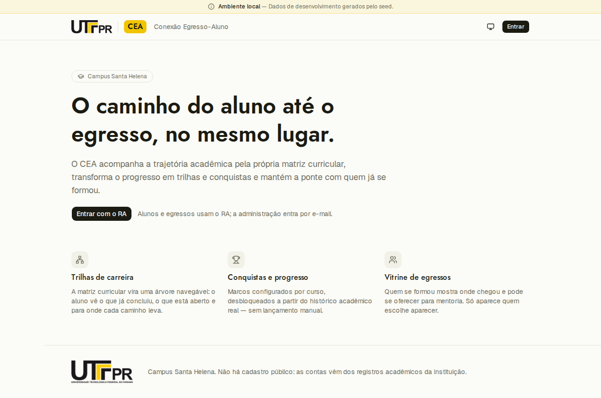
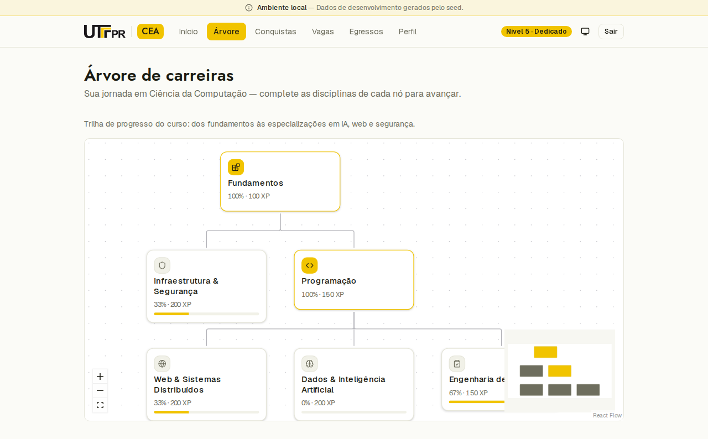
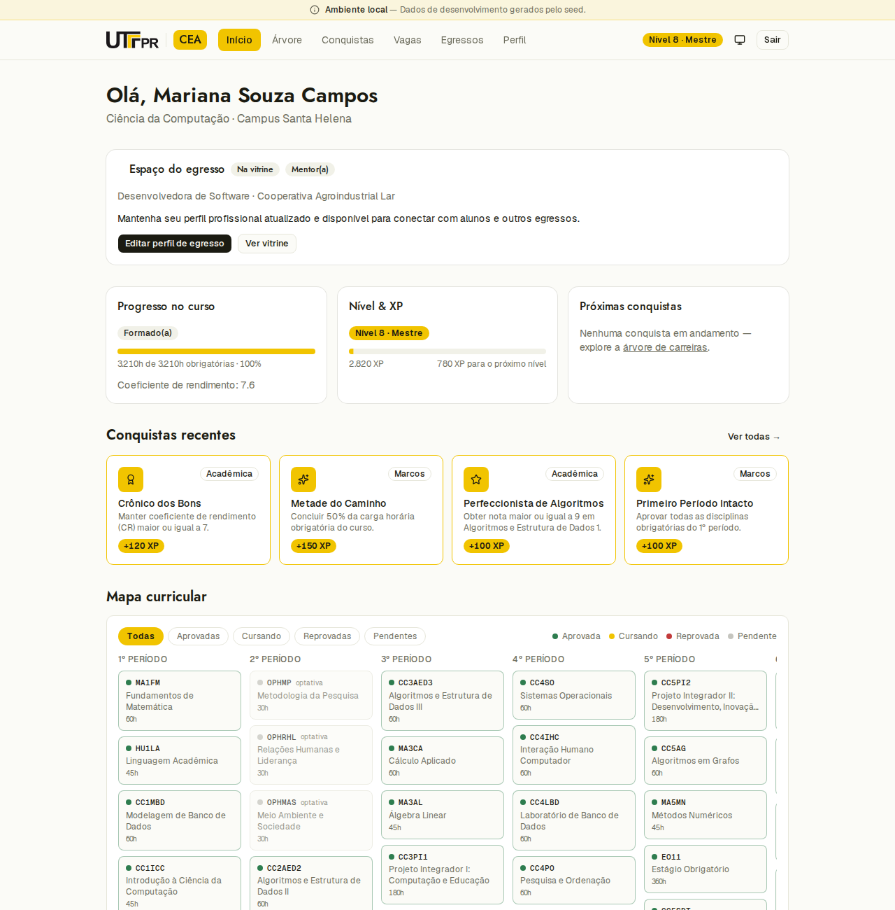
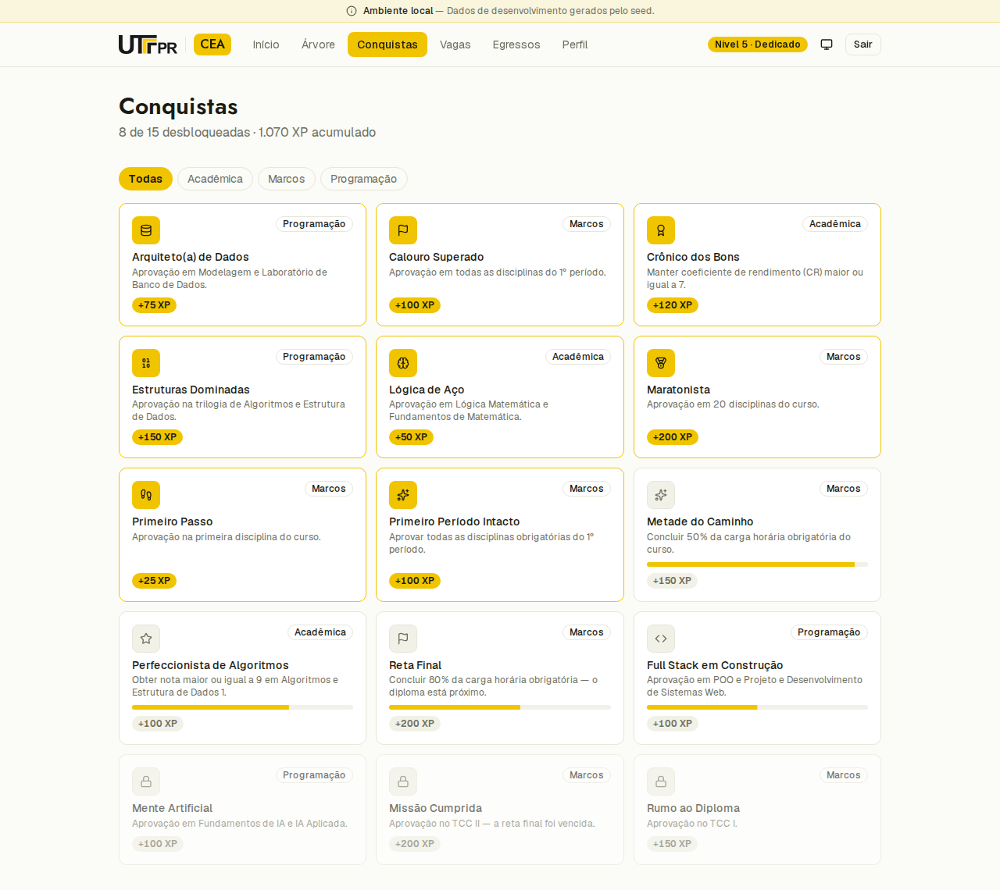
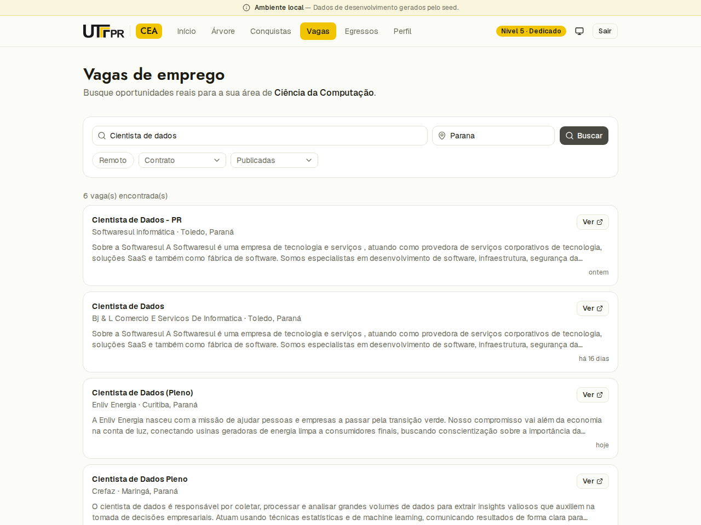
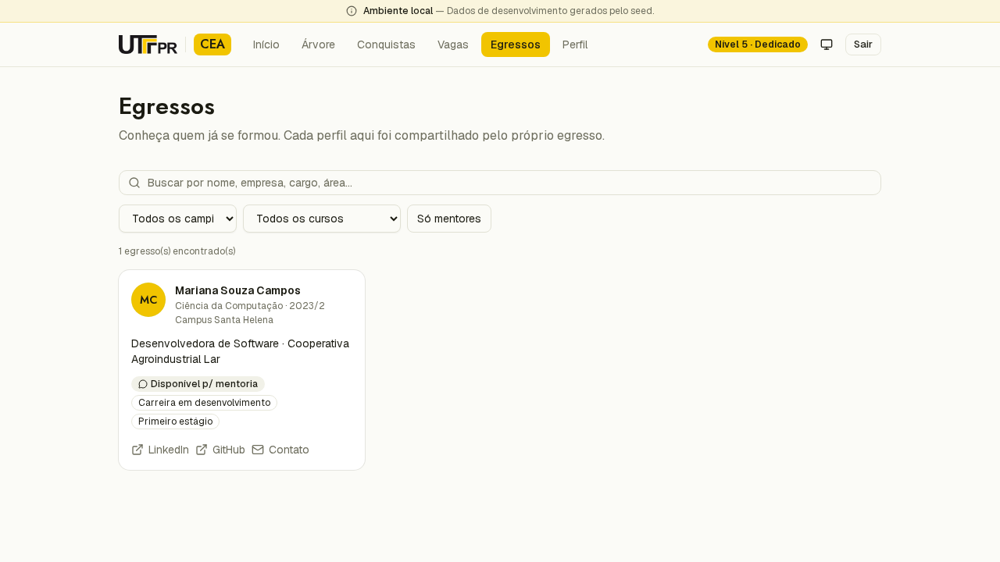
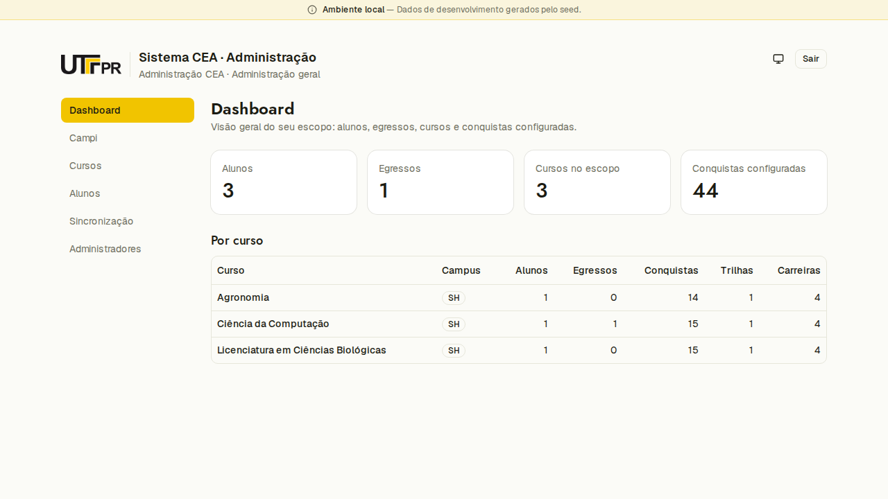
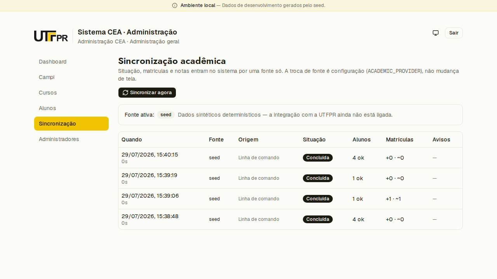

# CEA: Alumni-Student Connection

**English** · [Português](README.md)

A web platform that connects the alumni and the current students of UTFPR (Federal University of
Technology – Paraná). Students follow their academic progress on a career tree, earn achievements,
search jobs related to their course and find alumni who offer mentoring. Administrators see totals by
course and an auditable history of the academic data syncs.

> **Research project** at UTFPR, Santa Helena campus. The software is registered with INPI (Brazilian
> National Institute of Industrial Property).
>
> **This is not free software.** The code is public for scientific transparency and peer review. You
> can read it and cite it. You cannot use, copy, change or redistribute it. See [LICENSE](LICENSE)
> (in Portuguese).

## Live demo

**<https://utfpr-egresso.vercel.app>**. The demo uses only synthetic data. The test logins are in
[`app/README.md`](app/README.md).

| Home page | Career tree |
|---|---|
|  |  |
| **Student dashboard (alumna view)** | **Achievements** |
|  |  |
| **Job search** | **Alumni showcase** |
|  |  |
| **Admin dashboard** | **Academic data sync** |
|  |  |

The user interface is in Portuguese. The code is in English.

## Repository layout

| Folder | What it is |
|---|---|
| [`app/`](app/) | **The current system.** Next.js + Prisma + PostgreSQL. Multi-campus and multi-course. |
| `core/`, `utfpr_egresso/` (root) | The first proof of concept, in Django. It is **frozen** and will be removed after the transition. Its documentation is in the [Portuguese README](README.md). |

## Stack (current system)

Next.js 16 (App Router) · TypeScript (strict) · Prisma 7 · PostgreSQL 17 (Docker) · Tailwind CSS 4 ·
Better Auth · Biome · Vitest · Playwright · GitHub Actions · Vercel + Neon

## Run it locally

Requirements: Node 20+, Docker.

```bash
cd app
cp .env.example .env && npm install   # 1. dependencies (also generates the Prisma Client)
npm run setup                          # 2. starts Postgres, applies the migrations, runs the seed
npm run dev                            # 3. http://localhost:3000
```

The seed creates the Santa Helena campus with its 3 courses and their real 2026/1 curricula
(311 subjects), the gamification data (achievements, tracks and careers by course) and the test logins.

## How it is built

- **Business logic lives only in `src/server/`.** Page components call services and contain no rules.
- **All content is data.** Subjects, achievements, tracks and levels are set per course in the
  database. Nothing is hard-coded.
- **One entry point for academic data.** Enrollments, grades and status come in only through the
  `AcademicDataProvider` interface, which is the integration layer with the university systems.
- **Fail-fast configuration.** In production, a missing, short or example secret, or an auth URL
  without HTTPS, stops the start-up.
- **Structured logs with redaction.** One JSON line per event. Keys such as `password`, `secret`,
  `token` and `cookie` become `[redacted]`, and credentials in connection strings are masked. Users
  get a generic message; the full error goes only to the log.
- **Backups that are tested.** Scripts dump and restore PostgreSQL inside the `postgres:17-alpine`
  image, so the client and server versions always match.

## Tests and CI

GitHub Actions runs on every push and pull request that changes `app/`:

- **check:** Prisma schema validation, Biome lint, `tsc --noEmit` and the Vitest unit tests.
- **e2e:** starts PostgreSQL 17, applies the migrations and the seed, and runs the Playwright suite
  (public pages, student, alumni, admin, authentication, security and rate limit). The report is
  saved as an artifact when a test fails.

## Data

All data that the seed creates (students, alumni, enrollments, grades) is **synthetic**. The test
logins are published on purpose: the demo has no data of real people. When the integration with the
university data goes to production, real data stays in the database and never goes into the
repository.

## Contributing

The repository is public for reading and review, but it **does not accept external contributions**.
To report a security problem or a factual error, open an issue with a description (no code).

## License

**Proprietary, all rights reserved.** Copyright (c) 2026 Erick Bonruque and UTFPR. You can read the
code, review it for academic purposes and cite it with attribution. You cannot use, run, copy, change or
redistribute it, and no patent license is granted. Full text in [LICENSE](LICENSE) (in Portuguese).
